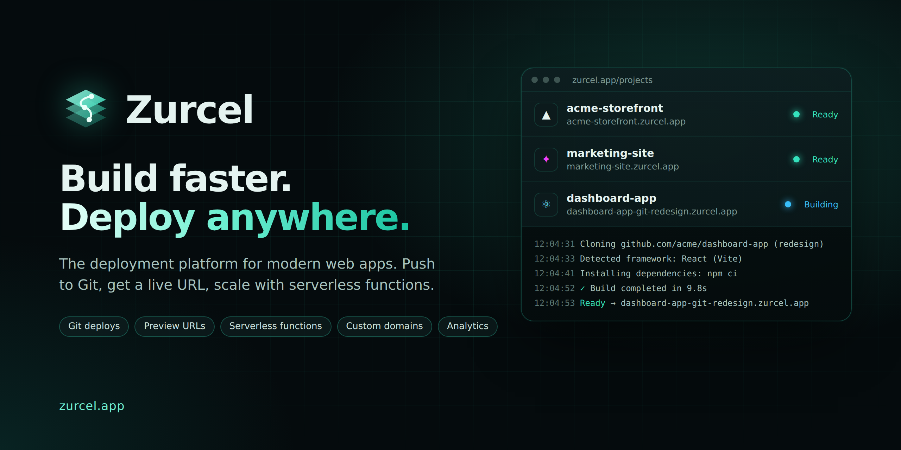
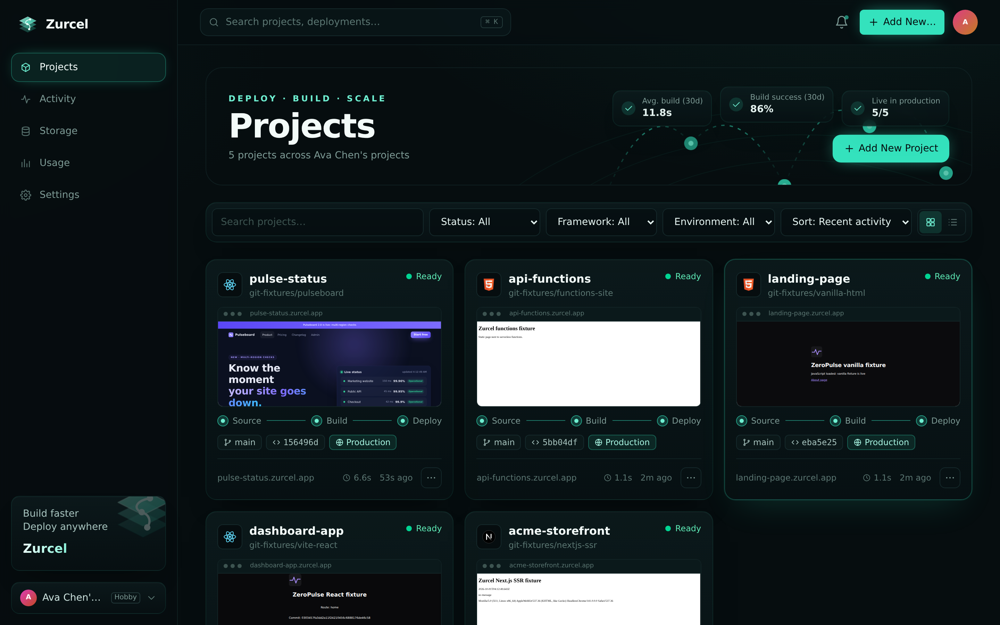
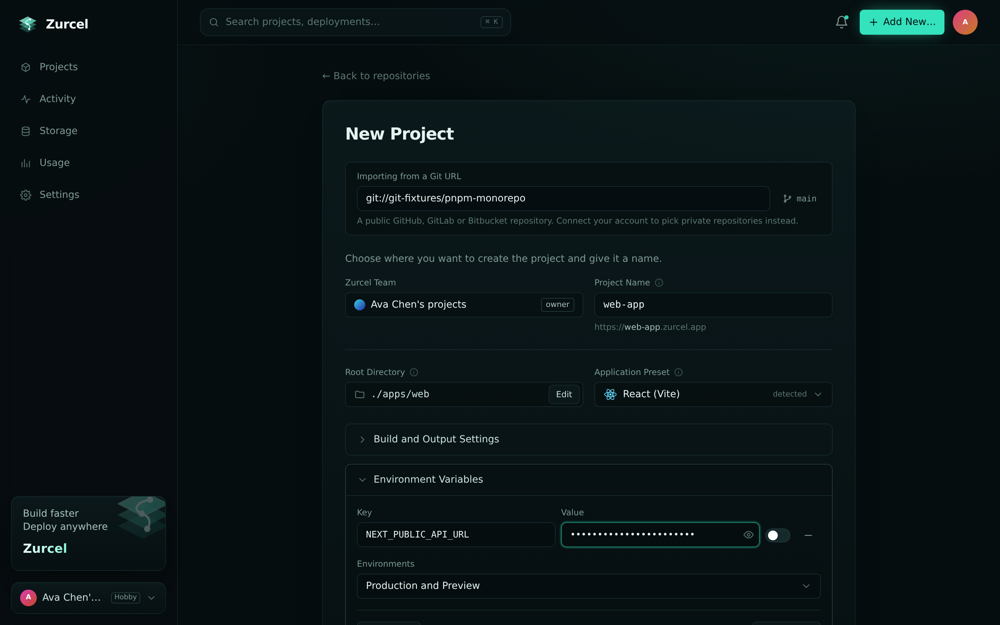
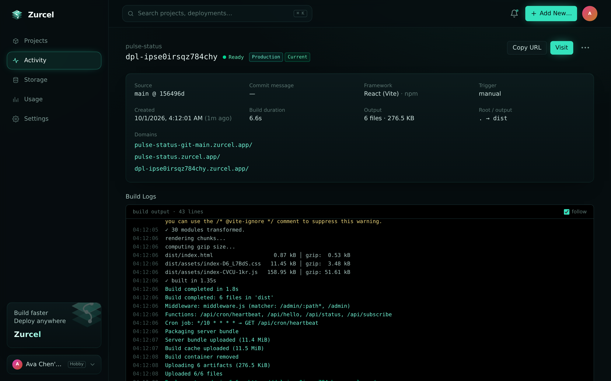
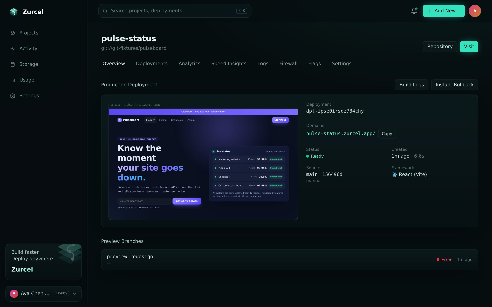
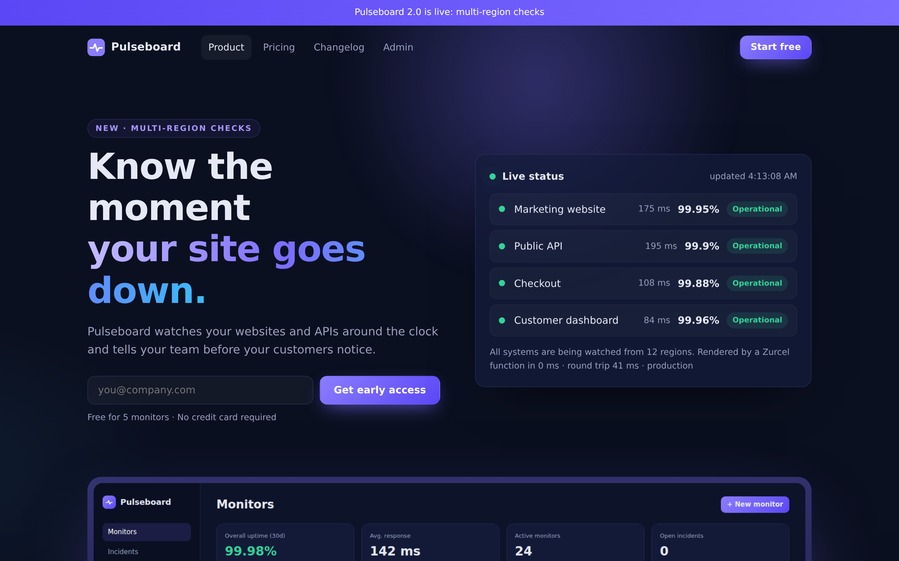

<p align="center">
  <a href="https://zurcel.app">
    
  </a>
</p>

<h1 align="center">Zurcel</h1>

<p align="center">
  <strong>The deployment platform for modern web apps.</strong><br>
  Connect a Git repository and every push becomes a live, shareable URL.
</p>

<p align="center">
  <a href="https://zurcel.app"></a>
  <a href="https://zurcel.app/signup"></a>
  
  
</p>

<p align="center">
  <a href="https://zurcel.app"><b>Visit Zurcel →</b></a>
  &nbsp;·&nbsp;
  <a href="https://zurcel.app/signup">Create an account</a>
  &nbsp;·&nbsp;
  <a href="#features">Features</a>
  &nbsp;·&nbsp;
  <a href="#how-it-works">How it works</a>
  &nbsp;·&nbsp;
  <a href="#supported-frameworks">Frameworks</a>
</p>

---

## Overview

**Zurcel** takes your code from a Git push to a production website in seconds, with no servers
to set up and no pipelines to maintain.

- **Import** a repository from GitHub, GitLab or Bitbucket.
- **Detect.** Zurcel finds your framework and builds the app in an isolated container.
- **Publish.** The result goes live at `https://<your-project>.zurcel.app`.
- **Preview.** Every branch gets its own preview URL, so you can review changes before they
  reach production.
- **Roll back.** If something goes wrong, return to any earlier deployment in one click.

<p align="center">
  
</p>

## Features

### Deploy
| | |
| --- | --- |
| **Git integration** | Import from GitHub, GitLab or Bitbucket, including private repositories. Pushes deploy automatically. |
| **Preview deployments** | Each branch gets a stable URL like `my-app-git-feature.zurcel.app`. Every deployment also has a permanent URL of its own. |
| **Instant rollback** | Promote any earlier deployment to production in seconds, with no rebuild. |
| **Monorepo support** | Pick the app's folder in a visual Root Directory browser; Zurcel detects the framework in each folder. |
| **Build settings** | Detected install and build commands and output folder, each with an optional override. |
| **Environment variables** | Separate values for production and preview, encrypted at rest. Import them from a `.env` file. |
| **Deploy hooks and CLI** | Trigger deployments from any CI system, or with the `zurcel` command-line tool. |

### Run
| | |
| --- | --- |
| **Serverless functions** | Add files under `api/` and they become HTTP endpoints, with logs and per-function timeouts. |
| **Server rendering** | Next.js, SvelteKit, Nuxt, Astro, Remix and Node.js servers run as managed processes. |
| **Routing middleware** | Redirect, rewrite or block requests before they reach your app. |
| **Cron jobs** | Run scheduled functions on your production deployment. |
| **Routing rules** | Clean URLs, redirects, rewrites and custom headers through `zurcel.json`. |
| **Image optimization** | Responsive, modern-format images (AVIF and WebP) on the fly. |
| **Storage, edge config and flags** | Blob storage, key-value configuration and feature flags with gradual rollouts. |

### Observe
| | |
| --- | --- |
| **Live build logs** | Watch every build step as it happens. |
| **Runtime and request logs** | Search function output and every request your site serves. |
| **Web Analytics** | Privacy-friendly visitor stats and custom events, without cookies. |
| **Speed Insights** | Core Web Vitals measured from real visits. |
| **Log drains and alerts** | Stream logs to your own tools and get notified when deployments fail. |

### Secure
| | |
| --- | --- |
| **Automatic HTTPS** | Every site and custom domain is served over HTTPS. |
| **Custom domains** | Bring your own domain, with guided DNS setup and verification. |
| **Deployment protection** | Keep previews, or whole projects, private to your team. |
| **Web application firewall** | IP blocking, custom rules and rate limiting per project. |
| **Accounts** | Sign in with email, GitHub or Google, with two-factor authentication and recovery codes. |
| **Teams** | Invite collaborators with roles, personal access tokens and an audit log. |

## How it works

```
  git push ──▶  Zurcel  ──▶  isolated build  ──▶  live HTTPS URL
                  │              │                       │
                  │              ├─ detects framework     ├─ my-app.zurcel.app        (production)
                  │              ├─ installs & builds     ├─ my-app-git-feature…      (preview)
                  │              └─ packages functions    └─ dpl-xxxx.zurcel.app      (immutable)
                  │
                  └─ live logs, analytics, rollbacks, domains
```

1. **Connect.** Sign in and import a repository; Zurcel reads its folders and detects the framework.
2. **Build.** Each deployment builds in a fresh, isolated container with your environment variables.
3. **Ship.** Static files, functions and server code go live behind HTTPS with zero downtime.
4. **Iterate.** Every push deploys automatically. Branches get previews and `main` updates production.

<table>
  <tr>
    <td width="50%"></td>
    <td width="50%"></td>
  </tr>
  <tr>
    <td align="center"><sub>Import a project: root directory, preset and environment variables</sub></td>
    <td align="center"><sub>Every deployment: URLs, details and live build logs</sub></td>
  </tr>
  <tr>
    <td width="50%"></td>
    <td width="50%"></td>
  </tr>
  <tr>
    <td align="center"><sub>Project overview with a live preview of production</sub></td>
    <td align="center"><sub>The result, live at <code>pulse-status.zurcel.app</code></sub></td>
  </tr>
</table>

## Supported frameworks

| Framework | Static | Server rendering | Functions |
| --- | :---: | :---: | :---: |
| Next.js | ✓ | ✓ | ✓ |
| React (Vite) | ✓ | | ✓ |
| Vue (Vite) | ✓ | | ✓ |
| Vite | ✓ | | ✓ |
| SvelteKit | ✓ | ✓ | |
| Nuxt | ✓ | ✓ | |
| Astro | ✓ | ✓ | |
| Remix / React Router | | ✓ | |
| Node.js server | | ✓ | |
| Plain HTML | ✓ | | ✓ |

npm, pnpm and Yarn are detected automatically from your lockfile.

## Getting started

1. Go to **[zurcel.app](https://zurcel.app)** and create an account, or sign in with GitHub or Google.
2. Click **Add New → Project** and pick a repository.
3. Click **Deploy**. Your site is live at `https://<project>.zurcel.app` in seconds.

> **Public beta.** Zurcel is in early access and sign-ups may be invite-only while capacity
> grows. Usage limits apply per account.

## Trust and safety

- **Isolation.** Each deployment runs in its own isolated container, and each site is served
  from its own subdomain.
- **Secrets.** Environment variables are encrypted at rest and masked in build logs.
- **Acceptable use.** Phishing, malware and abusive content are not allowed. Report abuse at
  **[zurcel.app/abuse](https://zurcel.app/abuse)**. See the
  [Terms of Service](https://zurcel.app/terms) and
  [Acceptable Use Policy](https://zurcel.app/acceptable-use).

## About

Zurcel is built and operated by **ZeroPulse**.

- **Website:** [zurcel.app](https://zurcel.app)
- **Support and partnerships:** open an issue in this repository, or contact us through the
  website.

This repository is the public home of Zurcel. The platform's source code is private.

## License

Copyright © 2026 **ZeroPulse**. All rights reserved.

Zurcel, the Zurcel logo and this documentation are the property of ZeroPulse. No part of this
repository may be copied, modified or redistributed without written permission. See
[LICENSE](LICENSE) for details.

<p align="center">
  <a href="https://zurcel.app"></a>
</p>
